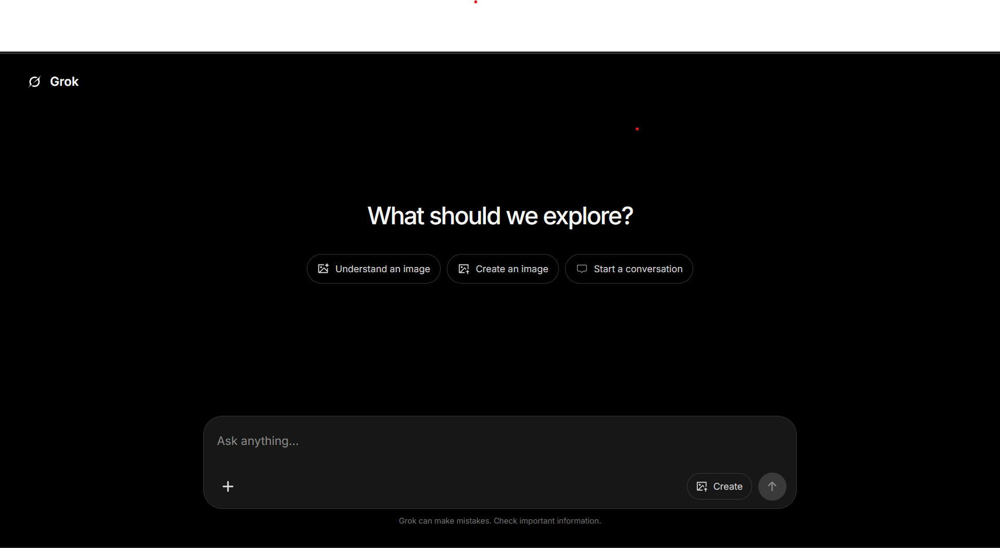

# Grok AI Companion

A responsive **React + Vite** chat application powered by the **Google Gemini API**.  
Chat with an AI companion, understand images, and generate new ones — all in a clean, dark-themed interface inspired by Grok.



---

## ✨ Features

- **Multi-turn conversations** — Full chat history is sent with every request so the AI keeps context
- **Image understanding** — Upload an image and ask questions about it (or let the AI describe it)
- **Image generation** — Switch to “Create” mode and describe the image you want
- **Download generated images** — One-click download of any AI-created image
- **Responsive design** — Works smoothly on desktop, tablet, and mobile
- **Modern dark UI** — Minimal, Grok-inspired interface with smooth interactions
- **Error handling** — Clear messages for missing API key, oversized images, or API failures
- **Accessibility** — Proper ARIA labels, focus states, and screen-reader support

---

## 🛠️ Tech Stack

| Layer          | Tools                          |
|----------------|--------------------------------|
| UI             | React 19                       |
| Build          | Vite 8                         |
| Icons          | react-icons                    |
| Styling        | Custom CSS (dark theme)        |
| AI             | Google Gemini API              |
| State          | React Context API              |
| Linting        | Oxlint                         |

**Models used**
- `gemini-3.8-flash` — chat & image understanding
- `gemini-2.5-flash-image` — image generation

Image uploads are limited to **10 MB**.

---

## 🚀 Getting Started

### Prerequisites

- Node.js **20.19+** or **22.12+**
- A free Gemini API key from [Google AI Studio](https://aistudio.google.com/app/apikey)

### 1. Clone the repository

```bash
git clone https://github.com/Souravbanerjeedata/ai-bot-react.git
cd ai-bot-react
```

### 2. Install dependencies

```bash
npm install
```

### 3. Add your API key

Create a file named `.env.local` in the project root:

```env
VITE_GEMINI_API_KEY=your_api_key_here
```

> **Important:** Never commit `.env.local`. It is already listed in `.gitignore`.

### 4. Start the development server

```bash
npm run dev
```

Open the URL shown in the terminal (usually `http://localhost:5173`).

---

## 📜 Available Scripts

| Command            | Description                              |
|--------------------|------------------------------------------|
| `npm run dev`      | Start the development server             |
| `npm run build`    | Create a production build in `dist/`     |
| `npm run preview`  | Serve the production build locally       |
| `npm run lint`     | Run Oxlint                               |

---

## 🔐 Production Key Security

Vite exposes any environment variable prefixed with `VITE_` to the browser bundle.

For a public deployment:

1. Move Gemini API calls to a **server-side endpoint** (Node, serverless function, etc.)
2. Keep the API key only on the server
3. Restrict the key in Google AI Studio (HTTP referrer / IP restrictions)
4. Never commit `.env.local` or any file containing the real key

---

## 📁 Project Structure

```
ai-bot-react/
├── public/
│   ├── favicon.svg
│   └── preview.png          # App screenshot (used in this README)
├── src/
│   ├── assets/
│   │   └── grok-icon.png
│   ├── pages/
│   │   ├── Chat.jsx         # Conversation view
│   │   └── Home.jsx         # Main UI + composer
│   ├── App.jsx
│   ├── context.jsx          # Global state (messages, input, feature, etc.)
│   ├── gemini.js            # Gemini API helpers
│   ├── index.css
│   └── main.jsx
├── .env.local               # Your API key (not committed)
├── index.html
├── package.json
└── vite.config.js
```

---

## 🎮 How to Use

1. **Start a conversation** — Type a message and press Enter (or click the send button)
2. **Understand an image** — Click the + button (or “Understand an image” on the welcome screen), select a photo, and ask a question
3. **Generate an image** — Toggle the **Create** button, describe what you want, and send
4. **Download** — Any generated image has a “Download image” link
5. **New chat** — Click the Grok logo in the top-left to reset the conversation

---

## 📝 Notes

- The app is purely client-side. All requests go directly from the browser to the Gemini API.
- Generated images are returned as base64 data URLs and can be downloaded immediately.
- The UI is fully responsive and respects `prefers-reduced-motion`.

---

## 📄 License

This project is open source and available under the [MIT License](LICENSE).

---

Made with ❤️ by [Sourav Banerjee](https://github.com/Souravbanerjeedata)
